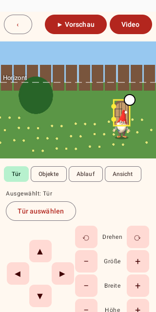
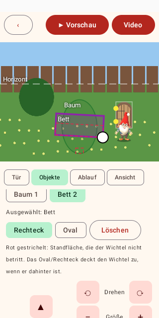
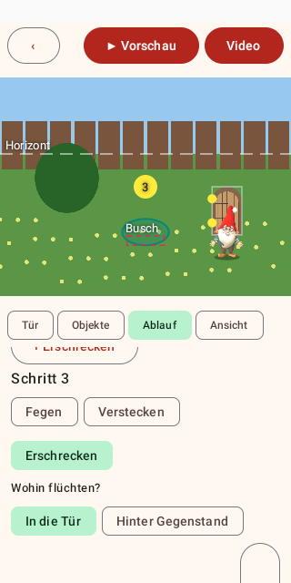
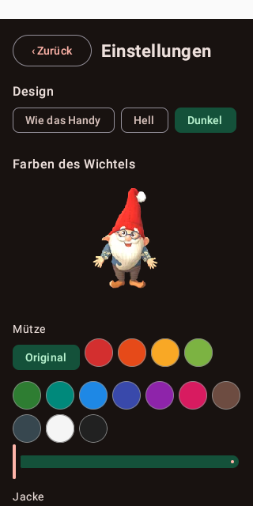
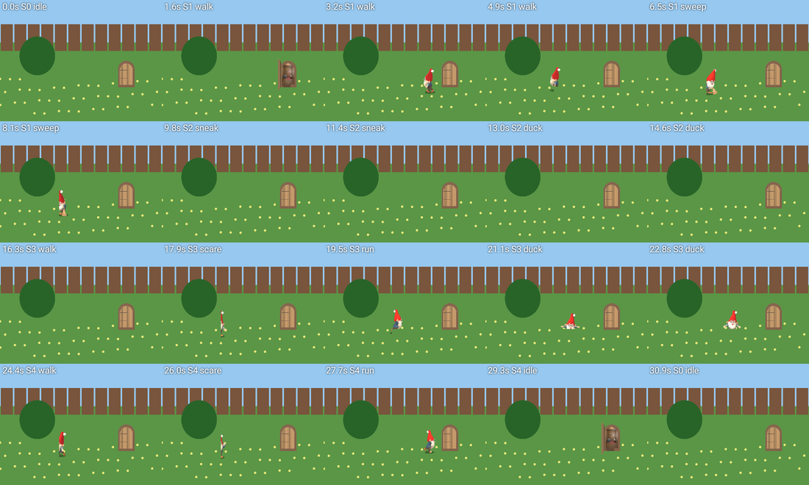
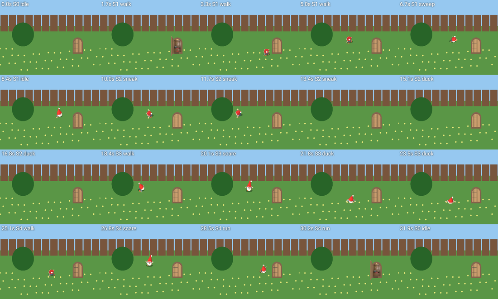

# Wichtelein2

Android-App (Kotlin, Jetpack Compose): Ein 3D-Wichtel läuft durch dein Foto. Komplett neu gebaut (Neustart bei Version 0.1.0),
nicht als Fortsetzung von Wichtelein. Der Wichtel und der Besen kommen aus Blender (FBX-Dateien), alles Gezeichnete
(Sprites, Tür, Innenräume, Symbol) entsteht per Skript in Blender (`blender/`).

## Was die App kann
- **Foto** aus der Galerie oder mit der Kamera; das Projekt (Foto, Plan) wird gespeichert.
- **Wichteltür**: Größe, Form (Rechteck, Rundbogen, Rund), Drehung und Platz einstellbar, Angelseite links/rechts und
  Aufschlag nach außen/innen (wie die echte Tür im Foto). Hinter der offenen Tür: schwarz, Stube, Höhle oder eigenes Bild.
- **Blickwinkel**: *seitlich* (Wichtel von der Seite, nach hinten kleiner, Horizont einstellbar) oder *von oben*
  (Wichtel von oben gesehen, überall gleich groß). Davon hängen Wegfindung und Bilder ab.
- **Gegenstände** aus dem Foto markieren (Bett, Baum, Haus, Leiter, Treppe, Gras, Busch, Stein, Zaun, Tisch, Kiste): Der Wichtel läuft
  drumherum (A*-Wegsuche, Gras bremst), kann sich dahinter verstecken und wird vom Foto-Ausschnitt verdeckt.
- **Aktionen**: *Fegen* (mit Besen), *Verstecken* (geduckt schleichen, in die Tür oder hinter einen Gegenstand),
  *Erschrecken* (Hände hoch, Zusammenzucken, dann in die Tür rennen oder hinter einen gewählten Gegenstand).
- **Leiter und Treppe (ab 0.3.0)**: eigene Schritte „Leiter“ und „Treppe“ mit **Richtung** (hinauf unten → oben, hinunter oben → unten) und einem **Pfad**,
  den man im Foto einstellt (unteres und oberes Ende ziehen, wählen oder per Pfeile; ohne eigenen Pfad setzt die App ihn am markierten Gegenstand).
  Die Leiter wird senkrecht geklettert (Blick zur Leiter, abwechselnd Arme und Knie), die Treppe seitlich schräg gegangen (hohe Knie). Auf der Leiter/Treppe bleibt
  der Wichtel gleich groß und wird von ihr nicht verdeckt. „Hinunter“ steigt er erst hinauf, wenn er noch unten steht; vor jedem anderen Schritt und am Ende steigt er selbst wieder hinab.
- **Bearbeiten ohne Versehen (ab 0.3.0)**: Je Reiter (Tür, Objekte, Ablauf, Ansicht) ist nur dessen Ebene aktiv, alles andere ist gesperrt und blass. Gezogen wird nur,
  was ausgewählt ist. Im Reiter Ablauf bearbeiten Auswahl, Pfeile und „Verschieben“ immer genau den unten angeklickten Schritt. Der Wichtel steht beim Platzieren nicht vor der Tür
  (Schalter „Wichtel“ blendet ihn zur Größenkontrolle ein; im Reiter Ansicht ist er immer da).
- **Hilfe im Editor (ab 0.3.0)**: „? Hilfe“ in jedem Reiter, dazu eine Erklärung je Gegenstand, was er in der gewählten Ansicht bewirkt (seitlich oder von oben).
- **Startseite (ab 0.3.0)**: 9 weihnachtliche Hintergründe (Kamin mit Feuer und Strümpfen, Wichtel im Sessel, Weihnachtsbaum, Winternacht, Dorf, Fenster mit Adventskranz,
  Weihnachtsmann im Polarlicht, Wichteltür im Wald, Schneemann) mit Schneefall, flackerndem Feuer und funkelnden Lichtern; **eigene Hintergründe** aus der Galerie.
  Zu jedem Hintergrund gehört **Musik**: eine der vier Weihnachtsmelodien, eine eigene Musikdatei oder aus. Knopf „Hintergrund & Musik“, Musik auf der Startseite lässt sich ausschalten.
- **Platzieren** mit Pfeilen (hoch, runter, links, rechts), Drehen und Größe (auch direkt im Foto ziehen, Griff unten rechts).
- **Farben** des Wichtels (Mütze, Jacke, Hose, Schuhe) anpassbar; **Design** hell, dunkel oder wie das Handy.
- **Video** (MP4, ohne Ton) wird auf dem Handy gerendert und in „Filme/Wichtelein2“ gespeichert.
- **Update** wie bei Wichtelein: Prüfung gegen die GitHub-Releases, Fenster mit Änderungsprotokoll und „Jetzt updaten“.

- **Ton (ab 0.2.0)**: selbst erzeugte Geräusche, **jede Gruppe einzeln an/aus**: Besen beim Fegen, Pfeifen beim Fegen (Weihnachtslieder),
  Glocken-Melodie beim Fegen, Erschrecken („Huch“ / „Ohh“), Tür auf/zu mit Knarren und Knacken, Tip-Tap beim Laufen (mit Mützenglöckchen und Rascheln).
  Dazu Musik als Loop (Schneeflocke, O Tannenbaum, Jingle Bells, Stille Nacht) mit eigener Lautstärke. Vorschau spielt mit Ton, das Video bekommt eine
  AAC-Tonspur. **Der Wichtel spricht nicht** (Huch/Ohh sind Laute, keine Wörter).
- **AR-Wichtel (ab 0.2.0)**: Startseite → „AR-Wichtel“. ARCore erkennt den Boden, ein Tipp stellt die Wichteltür in den echten Raum. Der Wichtel kommt
  heraus, fegt, versteckt sich oder erschrickt (Auswahl: Alles / Fegen / Verstecken / Erschrecken), mit Ton. Von der Seite sieht man die seitlichen Bilder,
  von oben die Draufsicht, und er dreht sich passend, wenn man um ihn herumgeht. Braucht ein ARCore-Handy; ohne ARCore erklärt die App das.

## Vorschau (Bilder aus den Emulator-Tests)
| Editor | Objekte | Ablauf | Einstellungen (dunkel) |
|---|---|---|---|
|  |  |  |  |

Ablauf mit allen Aktionen, seitlich und von oben (Kontaktbögen aus `SequenceTest`):




## Aufbau
| Ordner | Inhalt |
|---|---|
| `app/src/main/java/app/wichtelein2/core` | Reiner Kotlin-Kern ohne Android: Modell, `NavGrid` (Wegsuche), `Simulator` (Ablauf Bild für Bild), `Recolor`, `EditOps`, `PlanJson` |
| `.../render` | `SpriteLibrary`, `Renderer` (Foto, Tür, Wichtel, Verdeckung), `Exporter` (MediaCodec) |
| `.../ui`, `.../data` | Oberfläche (Compose), Speicher, Update-Prüfung |
| `blender/` | Skripte, die alle Bilder erzeugen (siehe unten) |
| `app/src/test`, `app/src/androidTest` | JVM-Tests des Kerns, Emulator-Tests (Rendern, Video-Export, Bedienung) |

## Blender
Quellmodelle (nicht im Repo, zu groß): `Downloads/3DWichtel` (Wichtel mit Mixamo-Skelett, ohne Animation) und
`Downloads/3DWichtel/3DBesen`. Pfade lassen sich mit `WICHTEL_FBX` / `BESEN_FBX` überschreiben.

```
B="D:/Media/Programme/PortableApps.com/PortableApps/Blender5/blender.exe"
$B --factory-startup -b -P blender/render_sprites.py -- <render>/sprites --res 448   # 2 Ansichten x 8 Richtungen x Bilder + Farbmasken
$B --factory-startup -b -P blender/render_door.py -- <render>/door
$B --factory-startup -b -P blender/render_interior.py -- <render>/interior
$B --factory-startup -b -P blender/render_icon.py -- <render>/icon.png
python blender/pack_assets.py <render> app/src/main
```
Weitere Bewegungen (ab 0.3.0): `climb` (Leiter) und `stairs` (Treppe). Nur sie neu rendern und packen:
`$B ... render_sprites.py -- <render>/sprites --anims climb,stairs` und `python blender/pack_assets.py <render> app/src/main --only climb,stairs`.
Die Bewegungen (Laufen, Schleichen, Rennen, Fegen, Erschrecken, Ducken, Klettern, Treppe) sind in `blender/wichtel_poses.py` als Posen für das
Skelett beschrieben; die Haende am Besen setzt eine kleine IK in `render_sprites.py`. Die Farbmaske (Mütze rot, Jacke grün,
Hose blau, Schuhe gelb) entsteht in `wichtel_lib.py` aus der Textur (Farbton und Höhe).

## Startbilder
Die neun Startbilder zeichnet `tools/make_backgrounds.py` (Python mit Pillow und numpy, eigene Illustrationen aus einfachen Formen, Verläufen und Leuchten):
`python tools/make_backgrounds.py app/src/main` schreibt `assets/backgrounds/*.webp` und `backgrounds.json` (was animiert wird, Standard-Melodie je Bild).
`--preview <Ordner>` erzeugt nur PNG-Vorschauen (`--only kamin,dorf` für einzelne Bilder).

## Tests
- Kern lokal und in CI: `./gradlew testDebugUnitTest` (JVM, Arbeitsordner `app/`).
- Emulator (nur CI): Rendern aller Bewegungen, Tür/Verdeckung, Video-Export mit Kontrolle der MP4-Datei, Bedienung der Oberfläche;
  Bilder davon liegen als Artefakt `emulator-screenshots`.

## Release
Push auf `main` baut die signierte APK (`.github/workflows/android.yml`, Tag `build-N`). Gebaut wird nur in GitHub Actions.
Voraussetzung sind die Secrets `ANDROID_KEYSTORE_BASE64`, `ANDROID_KEYSTORE_PASSWORD`, `ANDROID_KEY_ALIAS`, `ANDROID_KEY_PASSWORD`.
